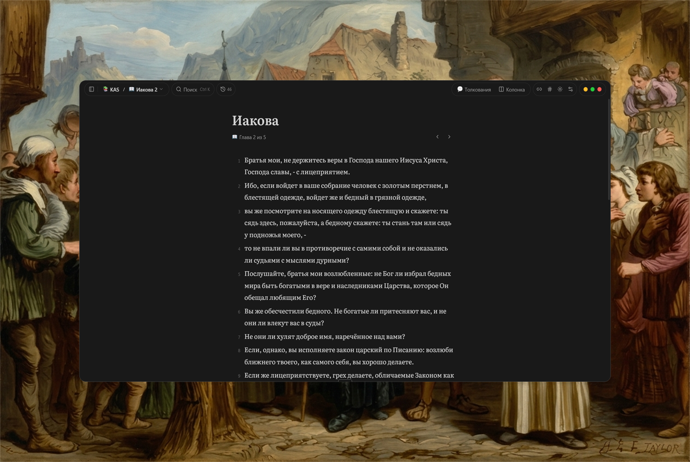
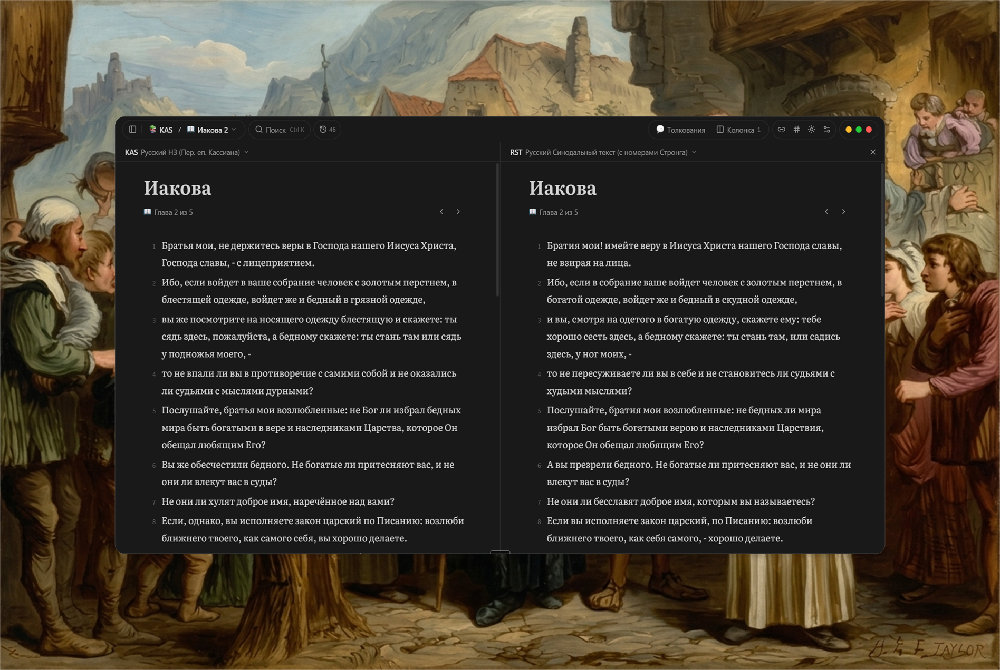
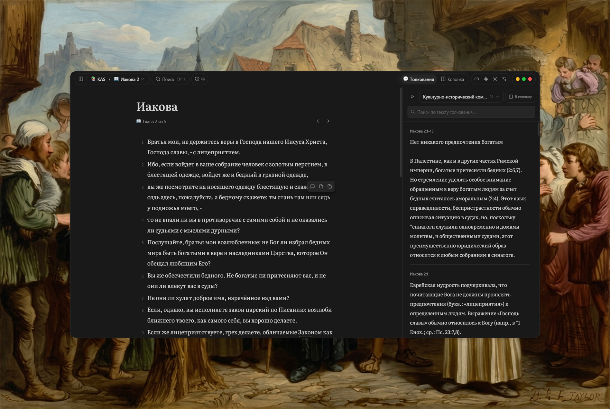
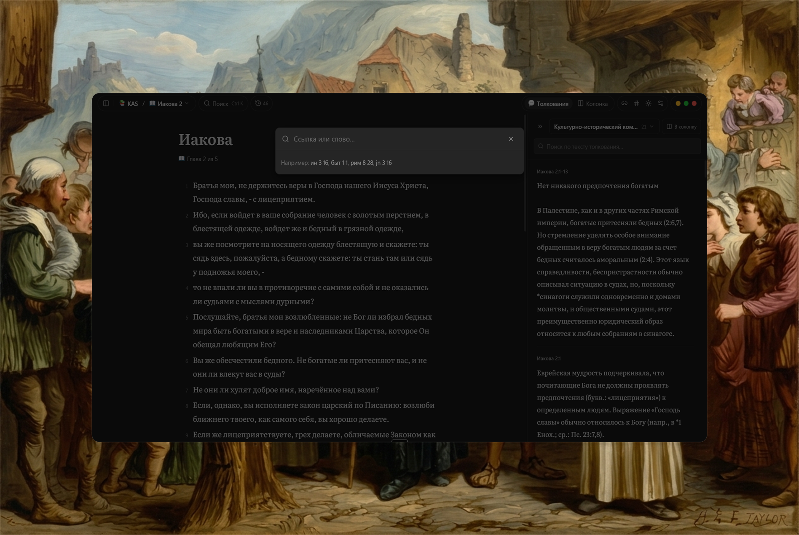
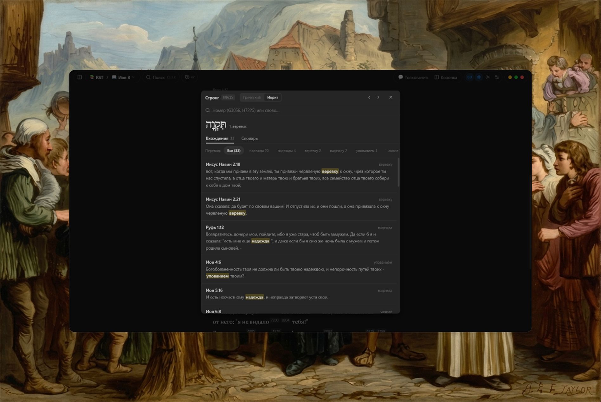
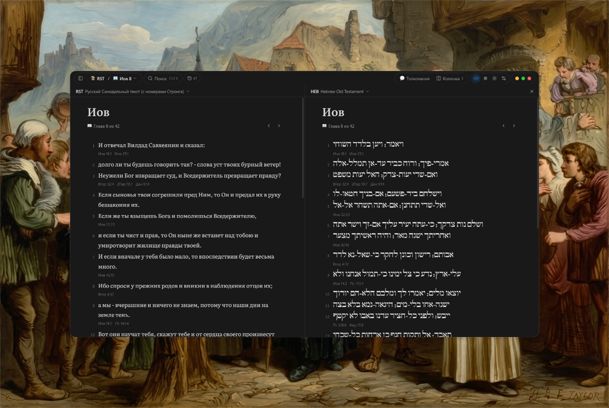

# Sola Scriptura

### Программа для чтения и глубокого исследования Священного Писания

> *«Исследуйте Писания, ибо вы думаете чрез них иметь жизнь вечную; а они свидетельствуют о Мне.»*  
> — **От Иоанна 5:39**

 

---

**Sola Scriptura** — настольная программа для чтения, сравнения и вдумчивого изучения Библии на компьютере. Без рекламы, сборов и необходимости подключения к интернету.

---

## 📥 Скачать для Windows

| Версия | Описание | Загрузка |
| :--- | :--- | :--- |
| **Установщик** | Стандартная установка с созданием ярлыка на рабочем столе | [**Скачать SolaScriptura-Setup.exe**](https://github.com/lucas23456/Bible-Releases/releases/latest/download/SolaScriptura-Setup-1.0.4.exe) |
| **Портативная версия** | Не требует установки: запускается из любой папки или с флешки | [**Скачать Portable.exe**](https://github.com/lucas23456/Bible-Releases/releases/latest/download/Bible-Portable.exe) |

> Все версии программы и история обновлений доступны в разделе **[всех выпусков (Releases)](https://github.com/lucas23456/Bible-Releases/releases)**.

<b>💡 Если Windows показывает предупреждение при первом запуске</b>

 

При первом запуске защитник Windows (SmartScreen) может показать синее окно: *«Защитник Windows предотвратил нераспознанный запуск»*.  
Чтобы продолжить: нажмите **«Подробнее»** (More info) $\rightarrow$ **«Выполнить в любом случае»** (Run anyway).

---

## 📖 Возможности программы

### 📑 Параллельное чтение переводов
Открывайте и сравнивайте разные переводы Библии бок о бок в параллельных колонках (Синодальный, современные переводы, подстрочники).

  

### 💬 Толкования и комментарии
Чтение текста Писания вместе с классическими комментариями:
* Толковая Библия А. П. Лопухина;
* Учебная Библия Джона МакАртура;
* Комментарии Уильяма Баркли;
* Святоотеческие и исторические толкования.

  

### ⚡ Быстрый переход и поиск (`Ctrl + K`)
Мгновенный переход к любой книге и главе по короткому названию (например, `ин 3 16`, `рим 8 28` или `пс 22`), а также быстрый поиск по ключевым словам.

  

### 🔢 Словарь Стронга и симфония номеров
Включение номеров Стронга в один клик: нажимайте на любое слово в тексте, чтобы увидеть оригинальный древнегреческий или древнееврейский корень, огласовки, транслитерацию и подробное словарное толкование.

  

Переходите во вкладку **«Вхождения»**, чтобы мгновенно увидеть симфонию — все места в Писании, где встречается это же слово на языке оригинала, с подсветкой в контексте:

  

### 📜 Языки оригинала
Полноценное чтение Ветхого Завета на древнееврейском языке (Танах с огласовками и знаками кантилляции) и Нового Завета на древнегреческом языке, в том числе параллельно с любым русским переводом.

  

* **Перекрёстные ссылки** — список параллельных мест Писания под каждым стихом с возможностью быстрого перехода.
* **Поддержка модулей «Цитаты из Библии»** — возможность открывать классические модули формата BibleQuote.
* **Личные заметки и маркер** — выделение стихов цветом и сохранение собственных пометок.

---

## 💬 Обратная связь

Если вы заметили неточность в тексте или у вас есть пожелание по работе программы:

* Откройте обращение в разделе **[GitHub Issues](https://github.com/lucas23456/Bible-Releases/issues)**.
* Опишите, в какой книге или в каком месте возник вопрос.

---

## 📄 Лицензия

Программа распространяется свободно под лицензией **MIT License**. Вы можете свободно использовать её для личного изучения, проповеди и служения.
